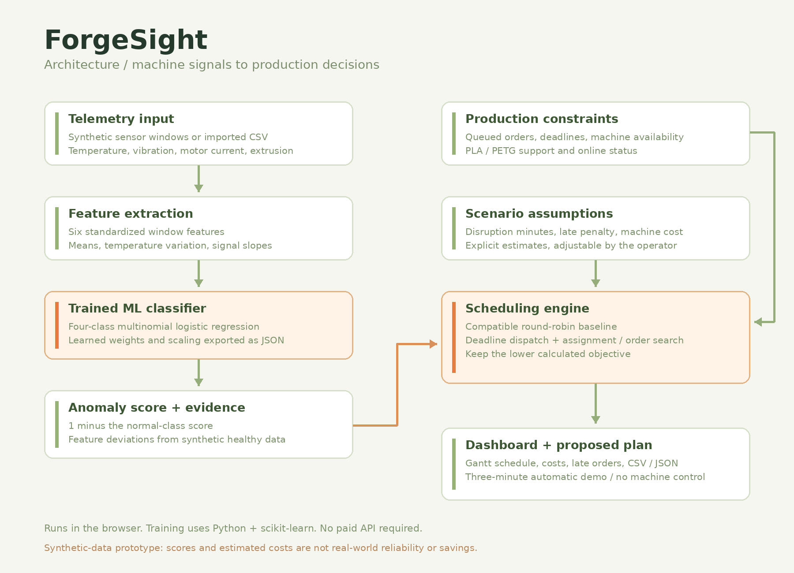
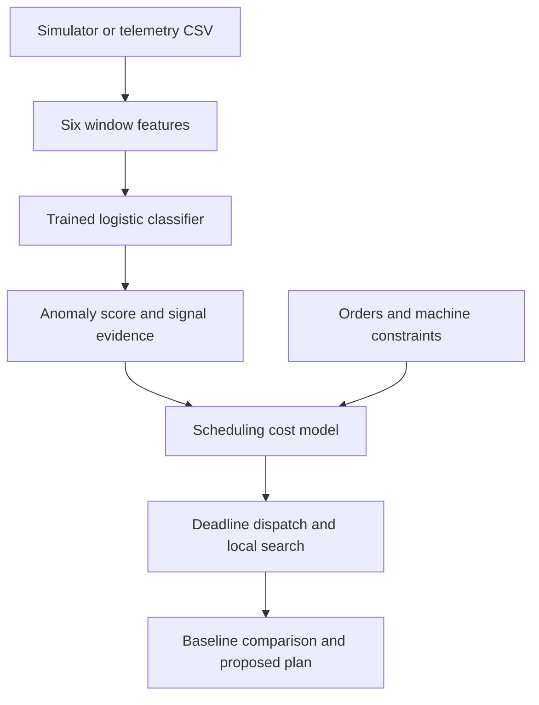

# ForgeSight

### Manufacturing Intelligence & Maintenance Decision Support

**Machine signals → explainable anomaly scores → smarter production schedules.**

ForgeSight is a browser-based AI + Business prototype for small 3D-print farms. It connects abnormal sensor patterns with the practical question an operator faces next: **which machine should receive the next order?**

Monitor six simulated printers, inject faults, inspect model evidence, and compare production schedules using explicit business-cost assumptions.

[Open the public live demo](https://forgesight.stableash8.chatgpt.site) · [Submission description](submission.md)

**Judges:** the live demo is public and needs no local installation. Open the link above and press **Start demo · 3 min**.



## Start the automatic demo

Click **Start demo · 3 min** in the application header.

After a three-second countdown, a complete 180-second guided sequence plays automatically. It introduces the problem, shows sensor readings, injects an extrusion fault, explains the classifier, animates calculated job reassignments, and presents the scenario results.

- **Space:** pause or resume.
- **Left / right arrows:** previous or next chapter.
- **Escape:** exit.
- **Fullscreen / replay:** available in the demo controls.

On-screen text provides the narration; audio is not generated. Switching tabs pauses playback. Each replay uses the same deterministic scenario and runs independently of dashboard uploads.

**To record:** start your screen recorder, press Start demo, keep the tab visible, and stop recording at the completion screen. Fullscreen at 100% browser zoom is recommended.

## Features

| Component | What it does |
| --- | --- |
| Factory dashboard | Displays six printers, material support, availability, sensor readings, and anomaly scores. |
| Fault simulator | Generates extrusion blockage, thermal instability, and mechanical vibration at two severity levels. |
| Trained classifier | Runs four-class logistic regression from learned weights directly in the browser. |
| Explainable signals | Shows class scores and feature deviations from the synthetic healthy baseline. |
| Production planner | Compares compatible round-robin dispatch with deadline-aware dispatch and local search. |
| What-if analysis | Excludes offline machines and recalculates schedules using adjustable cost assumptions. |
| CSV import and exports | Validates telemetry files and exports sensor windows and analysis JSON. |
| Automatic presentation | Plays a three-minute guided demo with transitions, moving job assignments, and playback controls. |

## Run locally

The trained model is included. **No API keys, Python ML installation, or npm installation are needed to use the app.** Serve `dist/` using a static HTTP server.

From the extracted project folder:

```bash
python -m http.server 8000 --directory dist
```

On Windows, you can use:

```powershell
py -m http.server 8000 --directory dist
```

Then open **http://localhost:8000**.

Use a server rather than double-clicking `index.html`, because the browser needs to load `model.json` over HTTP. Any static HTTP host works; Python above is simply one local-server option. Optional web fonts fall back to system fonts.

## Deploy with GitHub Pages

1. Upload the extracted project contents to a repository with a `main` branch.
2. Include **`.github/workflows/pages.yml`**; check that your upload method retained the hidden folder.
3. In **Settings → Pages**, set the source to **GitHub Actions**.
4. Run **Deploy ForgeSight to GitHub Pages** from **Actions**, or push a commit to `main`.
5. Open the Pages URL returned by the deployment and click **Start demo**.

The workflow publishes `dist/`. Add the resulting public URL to your repository's About section and hackathon submission. Viewing source files on GitHub does not execute the app.

## Architecture



**Frontend:** HTML, CSS, JavaScript.  
**Training:** Python, NumPy, scikit-learn.  
**Runtime inference:** JavaScript and exported JSON weights.  
**Hosting:** static HTTP hosting, including GitHub Pages.

## Machine-learning model

The classifier distinguishes four classes: **normal operation**, **extrusion blockage**, **thermal instability**, and **mechanical vibration**.

Each training window contains 30 samples at a nominal 10-second interval. The six features are temperature standard deviation, temperature slope, mean motor current, mean vibration, mean extrusion flow, and extrusion slope. Features are standardized before multinomial logistic regression.

| Evaluation item | Result |
| --- | --- |
| Training set | 3,600 synthetic windows; 900 per class; seed 41 |
| Test set | 1,200 held-out synthetic windows; 300 per class; seed 2026 |
| Held-out synthetic accuracy | 98.58% |
| Held-out macro F1 | 0.986 |

**Both datasets come from the same synthetic generator. These results do not establish performance on real equipment.**

The displayed anomaly score is **1 − the model's normal-class score**. It measures resemblance to simulated fault patterns, not calibrated physical failure probability or remaining machine life. Signal deviations are distances from the synthetic healthy baseline, rather than causal diagnoses.

### Retrain the model (optional)

```bash
python -m pip install -r requirements.txt
python train_model.py
```

This regenerates the learned weights and evaluation metadata in `dist/model.json`.

## Scheduling and cost assumptions

Only unstarted, queued orders are replanned. Existing jobs are represented by each machine's next-available time. Every assigned machine must be online and support the job's material.

The planner starts with deadline-aware dispatch, then searches alternate machine assignments and dispatch-order swaps for up to four passes. It retains the compatible round-robin baseline if the candidate objective is worse. This is a heuristic, not a guaranteed global optimum.

```text
interruption = anomaly_score × disruption_minutes
duration = job_minutes / machine_speed
finish = previous_machine_finish + duration + interruption
late_cost = max(0, finish − deadline) / 60 × late_penalty_per_hour
waste_proxy = anomaly_score × (material_cost + duration / 60 × machine_cost_per_hour)
objective = sum(late_cost + waste_proxy)
```

Model scores serve as scenario weights; disruptions are added per queued job. Displayed reductions are calculated cost-model comparisons, not measured savings or profit. Accepting a plan records a sandbox recommendation and sends no commands to physical printers.

## Import telemetry

Required CSV header:

```csv
machine_id,timestamp,temp_c,vibration_mm_s,motor_a,extrusion_mm_s
```

Example rows:

```csv
P01,0,210.20,1.12,1.35,4.40
P01,10,210.70,1.18,1.32,4.36
```

- Supported IDs: **P01–P06**.
- Timestamp units: numeric seconds, distinct and equally spaced per machine.
- At least **12 samples per machine**; the latest 30 are used.
- Use **30 samples at a 10-second cadence** to match the training format.
- File limit: **5 MB**.

Imported machines use frozen observation windows; unmatched machines remain simulated. Files are processed in the browser and are not uploaded. Shorter windows, other cadences, and unfamiliar operating conditions are outside the training distribution.

## Tests

With Node.js installed:

```bash
npm test
```

The suite contains 12 computational/timing tests plus application and presentation-controller smoke checks. It covers classification, score normalization, cost arithmetic, scheduling feasibility, CSV validation, the exact demo duration, all 14 chapters, pause/resume, visibility pausing, replay, and exit.

Browser visual testing was unavailable in the build environment. The smoke checks do not substitute for reviewing the app's layout and animation in a real browser.

## Project files

| File | Purpose |
| --- | --- |
| `dist/index.html`, `styles.css`, `app.js` | Dashboard and application interactions |
| `dist/engine.js` | Simulator, feature extraction, inference, CSV parser, scheduler |
| `dist/model.json` | Learned coefficients, scaling, baseline statistics, evaluation |
| `dist/demo.js`, `demo-core.js`, `demo.css` | Automatic presentation, scenario calculations, timing, animation |
| `train_model.py`, `requirements.txt` | Reproducible synthetic training pipeline |
| `tests/` | Computational, application, and playback checks |
| `.github/workflows/pages.yml` | GitHub Pages deployment |
| `submission.md` | Hackathon description and optional narration script |

## Next steps

Collect labeled real-printer telemetry, build machine-specific baselines, evaluate on held-out machines and time periods, calibrate scores, and compare scheduling recommendations with measured outcomes. Camera-based defect detection and physical machine integration are future features.

## Credits

**Project:** Ojas Upadhye · ForgeHacks 2026 · AI + Business.  
Development used ChatGPT/Codex assistance. The application's own ML component is the trained telemetry classifier described above. Training data is synthetic; no real-factory deployment, award, or operational savings are claimed.
